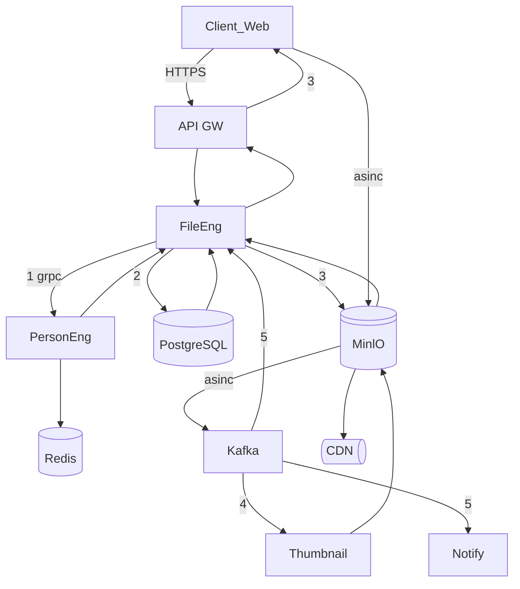
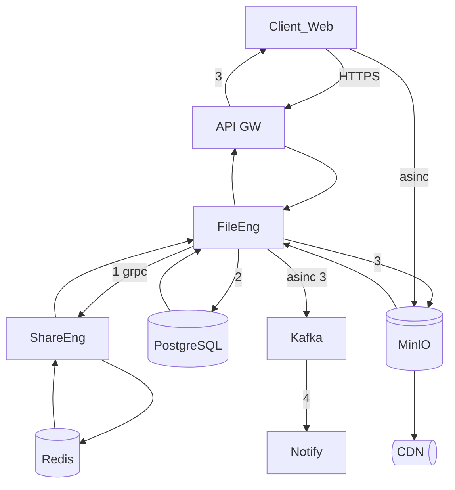

# ДЗ 1. Анализ референсной архитектуры — решение

> Условие: [../Задание.md](../Задание.md) · Чек-лист: [../Чеклист.md](../Чеклист.md)
> Схемы складывайте в [diagrams/](diagrams/).

## Выбранная архитектура

Облачное хранилище онлайн школы (платформы) веб версия.
(допустим ранее использоали гугл самую простую подписку, а яндекс и мэил ру запрещены политикой компании)
## 0. Контекст:
1. Система позволяет загружать,хранить,скачивать,удалять, искать файлы в рамках персонального облачного хранилища с возможностью онлайн просмотра, создания вложенной структуры директорий и ограничением доступ и права к файлам.
Допустимые форматы для онлайн просмотра: txt,docx,rtf,pdf,xslx,csv,png,jpeg,pptx. 
Допустимые форматы для комментирования: txt,docx,rtf,xslx,csv.
Доступные форматы для редактирования: txt,docx,rtf.
Файл/директория доступен по сформированной ссылке либо по предоставленному персональному доступу.
Допустимые к выбору права доступа: читатель, комментатор, редактор.
Аутентификация происходит посредством интеграции с платформой школы.
Материалы урока доступны студентам (роль читатель), преподавателям (редактор).
Для ДЗ у студента есть отдельная директория (роль редактор), преподаватели (комментатор).
Администратор редактор во всех директориях курса.
2. Акторы:
студенты (загрузка файлов ДЗ, удаление, редактирование онлайн, поиск файлов, чтение по предоставленному доступу к файлу урока, скачивание их, онлайн просмотр файлов урока, формировать ссылку на просмотр)
преподаватели (загрузка материалов урока, удаление, редактирование онлайн, чтение по предоставленному доступу файлов ДЗ и комментирование их, формировать ссылку на просмотр)
администраторы онлайн школы (создание вложенной структуры директорий,упраление правами доступа к директирориям, создание удаление скачивание, шеринг доступа и ссылок)
3. Загрузка файла - скачивание файла - формирование ссылки - просмотр файла - комментирование файла
4. Объем 1 файла не более 500Мб. Объем бесплатного хранения 5 Гб.
География РФ
   Редактирование одновременно несколькими пользователями не подразумевается.
Время отображения превью файла до 1с 
Время скачивания файла до 1 Мб - до 1.5 с до 4 при скачивании по сети Wifi, оптоволокно.
Время скачивания файла до 50 мб - до 4 при скачивании по сети Wifi, оптоволокно.
RPS в штатном режиме - 500 чтение просмотр, скачивание/загрузка - 100
RPS в режиме повышенной нагрузки - 5000 чтение просмотр, скачивание/загрузка - скачивание/загрузка - 500 

## 1. Компоненты

| Компонент                              | Stateless | Ответственнсть                                                                                                                                                                 |
|----------------------------------------|-----------|--------------------------------------------------------------------------------------------------------------------------------------------------------------------------------|
| Client Web (веб-браузер)               |           | Формирует запросы, хранит кэш                                                                                                                                                  |
| Веб морда (UI фронт)                   |           |                                                                                                                                                                                |
| API GW                                 | +         | маршрутизирует по назначению, балансирует, валидирует запросы                                                                                                                  |
| Service FileEng                        | +         | принимает запросы по изменению состояния файлов и ссылок на них,   считает хэш, пишет в БД метаданные, отправляет в storage,   формирует событие в кафку об изменениях |
| AuthPlatform (платформа обучения)      |           | (внешняя) принимает запрос от веб морды хранилища на аутентификацию пользователя от GW, формирует данные о сессии                                                              |
| Service Notify                         | +         | потребляет события из кафки и формирует отправку уведомления через smpt сервер                                                                                                 |
| Service PersonalEng                    | +         | принимает запрос на проверку пользовалеля, формирует gwt токен сесии, пишет в редис данные по сессии, создание новых пользователей                                             |
| Service ShareEng                       | +         | принимает запросы фиксацию разрешений пользователя на папки, прав на файлы, формирование ссылок на поделиться с учетом прав, отправляет в редис                                |
| Thumbnail                              |           | получает события от minlO и сжимает файлы для превью                                                                                                                           |
| DB Service FileEng (Metadata) Postgres |           | хранит метаданные ссылки на файлы в хранилище, пересчитывает индексы силами самой СУБД                                                                                         |
| DB Service PersonalEng Postgres        |           | хранит данные пользователя и состояние , статусах                                                                                                                              |
| Storage MinlO                          |           | записывает, хранит object по файлам загрузки, генерация временных ссылок на скачивание                                                                                         |
| DB Redis                               |           | хранит ссылки, кэш данные о сессии пользователя и актуальных правах                                                                                                            |
| SDN                                    |           | хранит кэш с файлами                                                                                                                                                           |
| Kafka                                  |           | принимает события изменений по файлам, уведомления                                                                                                                             |

## 2. Потоки данных

_3–5 ключевых сценариев со схемами._
1. Загрузка файла
    1 проверка прав и сессии
    2 запить первых данных в БД
    3 генерация ссылки на загрузку и отправка в браузер
    4 генерация превью сервисом Thumbnail
    5 уведомление о завершении и отправка полных метаданных в БД

2. Скачать файл (при условии что сессия активна)
    1 запросить права на скачку по пользователю
    2 проверить в БД есть ли файл
    3 получить ссылку на скачивание по идентификатору из бд сформировать ссылку и отдать клиенту
    4 отправить уведомление о завершении скачивания

3. Поделиться ссылкой на файл с правами на редактирование (админ)
 1 запросить права на файл по пользователю
 2 сформировать ссылку на файл в ShareEng положить в БД
 

## 3. Проблемы и решения

_Какие проблемы решает каждый компонент._

## 4. Вопросы к авторам архитектуры

_Минимум 5 неочевидных вопросов._
