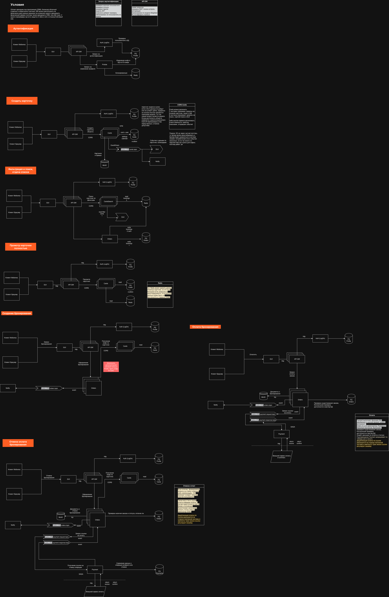
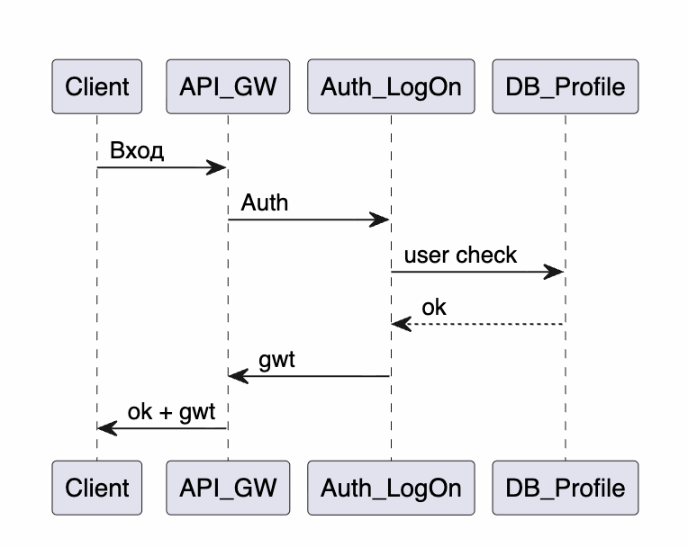
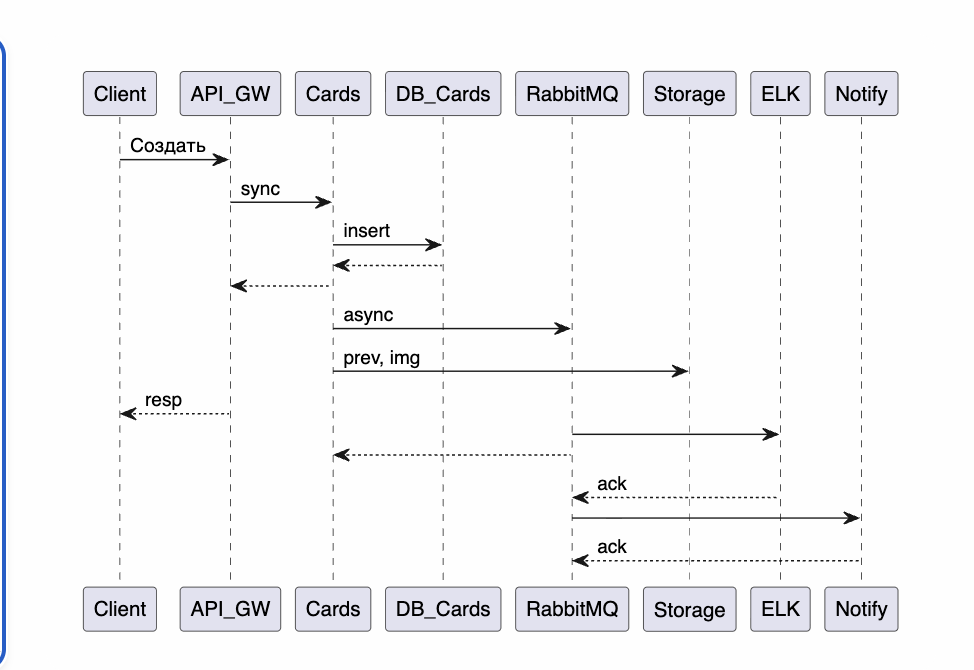
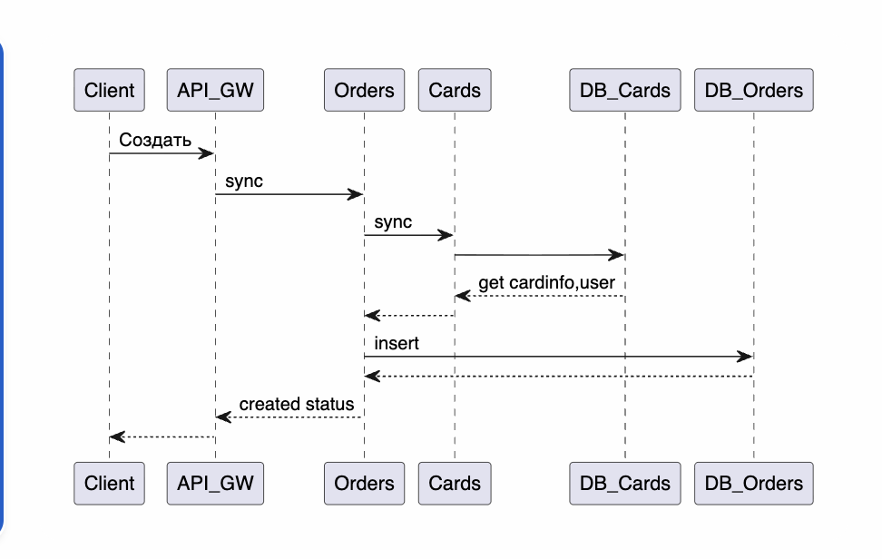
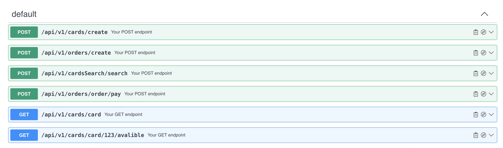

# ДЗ 2. Проектирование взаимодействия сервисов — решение

> Условие: [../Задание.md](../Задание.md) · Таблица протоколов: [../Таблица протоколов.md](../Таблица%20протоколов.md)
> Схемы складывайте в [diagrams/](diagrams/).

## Выбранная система

Сервис бронирования

## 1. Декомпозиция

| Компонент                | Описание                                                     | Ответственность                                                                                                                                                                      | Stateless |
|--------------------------|--------------------------------------------------------------|--------------------------------------------------------------------------------------------------------------------------------------------------------------------------------------|-----------|
| Фронт GUI                | Пользовательский интерфейс                                   | Формирует запрос к сервер, к GW                                                                                                                                                      | +         |
| API GW  Nginx            | API GateWay  балансировщик                                   | Принимает, прокситует запросы, проверка GWT токена, GW Routing, RL, также работает кэш для карточек                                                                                  | +         |
| Облачный балансировщик   | балансировщик перед GW , включает защиту от ddos и cdn       | маршрутизирует запросы на GW, RR, отказоустойчивость                                                                                                                                 | +         |
| Profile                  | сервис хранения пользователей, прав, ролей, описание, пароль | -обрабатывает запросы на создание юзеров, -возвращает идетификатора юзера по запросу от смежных сервисов, -блокировку, -апдейт инфо о пользовтателе, -смену пароля   | +         |
| Cards                    | сервис карточек объектов бронирования                        | создает, апдейтит, формирует выдачу по запросу сервиса списка, удаляет, меняет статус объектов                                                                                       | +         |
| CardSearch               | сервис оптимизированного поиска                              | совместно с ELK поиск по пользовательским фильтрам                                                                                                                                   | +         |
| Orders                   | сервис обрасотки заказов                                     | -формирование заказа, -изменяет стутс заказа, -подтверждает актуальности доступности объекта, -выполение отмены заказа с проверкой платежей, -кладет события для ELK | +         |
| Payments                 | сервис обработки платежей по внешней интеграции              | формирует платежный запрос на внешний сервис на оптату, обрабатывает статусы оплаты                                                                                                  | +         |
| Notify                   | сервис отправки уведомлений и файлов через SMTP              | получает сообщения о заказе (в тч email и id файлов), запрашивает файл и формирует пакет на отправку пользователбю на почту                                                          | +         |
| ELK                      | Сервис поиска                                                | Оптимизирвоанный поиск по карточкам объектов, фильтрация, имеет гео определение                                                                                                      | -         |
| Кеш Redis                | In-Mem БД для кэширования                                    | Для горячего чтения инфо о доступности объекта по ключу card_id, ссылки, история поиска по ключу user_id                                                                             | -         |
| Брокер RabbitMQ          | Асиххронные процессы                                         | Отправка событий в ELK и в Notify                                                                                                                                                    | +         |
| БД под сервисы Postgress | БД Orders, Payments, Profile, Cards                          | хранение, индексирование                                                                                                                                                             | -         |
| CDN                      | (входит в  Облачный балансировщик )                          | хранение статики                                                                                                                                                                     | -         |
| Хранилище                | Хранит файлы                                                 | кладет сформированное, отдает по запросу на скачивание фото, картинки, документы                                                                                                     | -         |

_6–8 сервисов с описанием ответственности._

## 2. Протоколы

_REST / gRPC / GraphQL / events — где и почему._
rest - между API GW и сервсами Cards, Profile, Orders. Также на внешниз взаимодействиях.

grpc - между API GW и сервсом CS из-за большого потока запросов которое требует большого кол-ва соединений
открытых, поэтому json-ы с данными будут ходить по каналу  а методы будут прописаны в proto.buf
применение в остальных взаимодействиях его в остальных не обосновано из-за трудоемкости его реализации, необходимыми компетенциями команд,
тестирование будет затруднено интеграционное. А сервис аутентификации его вообще не поддердивает.

events
выбран на участках где несколько потребитетей событий нотификаций и сообщений для ELK для обогащения хранилища ELK.
для обмена сообщениями с платежным сервисом и гарантией доставки. при необходимости можено посадить еще потребителя типа аудита.

## 3. Схема взаимодействия

_PNG/PlantUML с указанием протоколов (в diagrams/)._

## 4. API-контракты

_3–4 ключевых API (Swagger/OpenAPI или описание)._

 - полная версия с содержимым методов

## 5. Асинхронность

_Где применяется и почему._
Применяется в асинхронной отправке событий в ELK, уведомлений пользователям о бронировании, 
получение ссылки оплаты и ответов по оплате в разных топиках, а так же важна гарантия доставки в платежах.
Обосновано тем, что необходим холодный, фоновый тракт для разгрузки сервисов и синхронного тракта, по оплате нужно получение нескольких событий.
Выбран RabbitMQ из-за низкого порога входа по ресурсам, небольшого количества потребителей, простоты настройки,
возможности откладывать уведомления (умный брокер) из коробки и допустимыми хар-ками отказоустойчивости.
Как будто бы быстрее должна быть доставка в ELK событий обновлений, что для бронирования критично.

## 6. Паттерны
По оптимизации поиска:
необходимо ограничить выборку в ELK по простым фильтрам, далее читать редис с бронями отдельной ручкой, соблюдать иерархию
выдача на фронт должна быть лимитирована, валидация limit еще на gw при запросе поиска
Saga применена между Payment и Orders для обмена событиями и неоднократному. Сама оплата реализуется посредством платежной системы
ссылку на оплату Ecommerce создает эквайринг, где обслуживается ТСП.
ES - применен 
CQRS паттерн применяется в части реализации поиска и фильтрации, сервис CardSearch работает только в режиме чтения из 2х источников (ELK и Redis).
Сервис Cards работает на запись и на чтение, разделены на подходом Weighted RR балансировкой, но вообще предложила бы разнести потоки запросов по виртуальным серверам, чтобы поиск шел на одну а создание карточек на другую.
GW - применяем тут по кол-ву микросервисов и достаточности функций для проктирования и валидаций, 
RL установлен на конкретные эндпоинты поиска и получения карточек на уровне GW.
Предполагается облачный балансир перед двумя GW программными при масштабировании.
Развернуться можно на docker под упралвлением docker-compose

Также прошу обратить внимание на пометки на схемах.